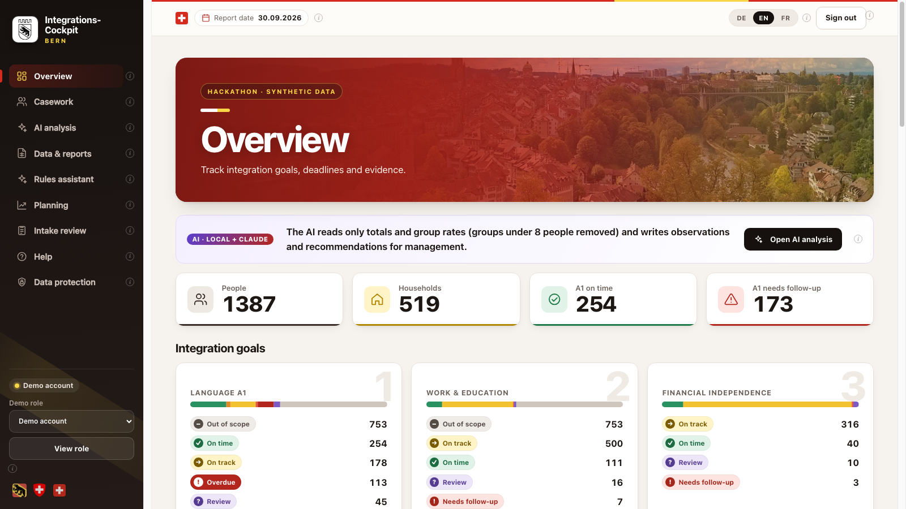
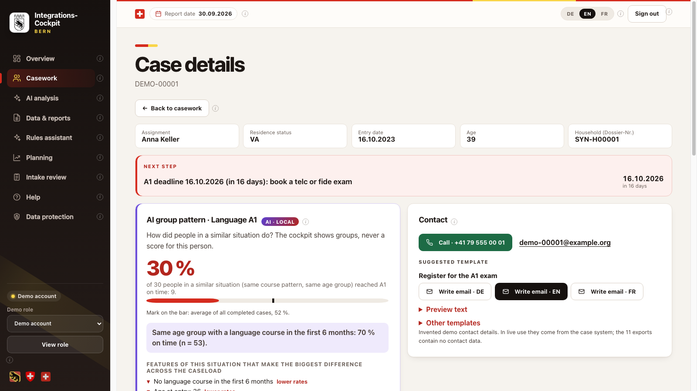
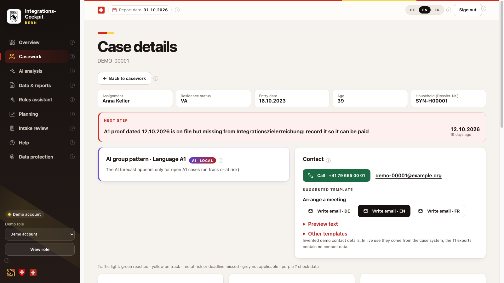
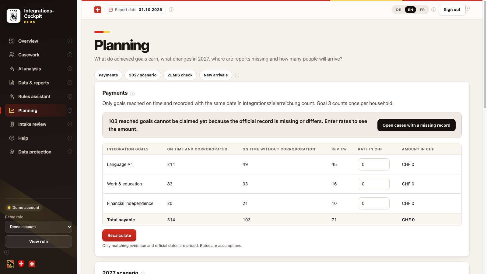

# Integration Cockpit Bern

**From eleven monthly Excel exports to the next action on a case.**

Integration Cockpit Bern is a prototype for the City of Bern’s asylum social service (ASD), built for the AI for Access hackathon. It shows caseworkers who needs a follow-up, which deadline applies, and which source rows support the result. Managers can track integration outcomes, check employment discrepancies, and explore planning scenarios.

[Run the demo](#run-the-demo) · [Explore the menus](#explore-the-menus) · [GitHub releases](https://github.com/hmnhoomandev/Integration-Cockpit/releases) · [Deutsch](docs/README.de.md) · [Français](docs/README.fr.md)



## Version and demo data

This README describes the default-branch code. The **v1.0.0** tag marks the published hackathon release. Since that tag, the default branch has gained a refreshed interface, local A1 group patterns, contact actions, an AI privacy shield, and Vercel support for a signed-in, synthetic-only demo. In the current case view, A1 patterns describe comparable groups and show how many people reached the goal on time. [Published v1.0.0 release](https://github.com/hmnhoomandev/Integration-Cockpit/releases/tag/v1.0.0) · [Changes since v1.0.0](https://github.com/hmnhoomandev/Integration-Cockpit/compare/v1.0.0...main)

All demo case records and contact details are fictional. The demo ships with reproducible snapshots for **30 September** and **31 October 2026**. The arrivals forecast labels its synthetic series and the public benchmark separately.

## Run the demo

Requires **Python 3.12+**. The default configuration uses only the Python standard library.

```sh
python3 -m cockpit.server --db runtime/readme-demo.sqlite serve --demo
```

Open **http://127.0.0.1:8000**. On the first run against a fresh database, the terminal prints the local demo credentials. Use the language switcher in the header to choose German, English or French.

### See one case change across two months

1. In **Data & reports**, select **30 September 2026**.
2. In **Casework**, search for **DEMO-00001**. A1 is due on **16 October**, and the suggested next action is to register for an exam.
3. Switch to **31 October 2026** in **Data & reports**, then reopen the same case. A fide certificate dated **12 October** now appears in the evidence. The goal was reached on time. The cockpit prompts the caseworker to record it in the official register so it can be claimed.

| September · Exam registration due | October · Certificate on file |
| --- | --- |
|  |  |

## Explore the menus

| Menu | What you can do |
| --- | --- |
| **Overview** | See the three integration goals, source coverage and monthly A1 trend. Compare A1 targets with on-time results by caseworker and entry year. Explore outcomes by factors such as course timing, with group sizes and uncertainty intervals. Download the aggregate analysis. |
| **Casework** | Work through the weekly follow-up queue, search and filter cases, and inspect deadlines, recommended actions, evidence and the timeline. Open contact actions and email templates. Eligible open A1 cases show local group patterns. |
| **AI analysis** | Review aggregate observations for management. A local summary remains available with external AI disabled. |
| **Data & reports** | Switch monthly snapshots, inspect source row counts and file fingerprints, and download the Excel report. The local installation can validate and import a new batch of eleven workbooks. |
| **Rules assistant** | Look up topics such as A1 eligibility or acceptable proof and see cited sources. Authorized synthetic-demo users can also explore supported questions about aggregate results. |
| **Planning** | Check estimated payments and missing official records, compare an illustrative 2027 responsibility scenario, investigate ZEMIS employment discrepancies, and review an arrivals forecast with holdout error and prediction intervals. |
| **Intake review** | Review a sample PDF, inspect the privacy shield and approve suggested categories before saving. The local installation also supports intake PDF uploads. |
| **Help** | Follow the product tour and look up terms. Small information icons explain individual controls throughout the app. |
| **Data protection** | See how data is processed and stored, who can access it, and when information can leave the installation. |



## How results are calculated

| Integration goal | Rule used by the cockpit |
| --- | --- |
| **German A1** | Eligible cases have a three-year deadline from entry. The cockpit evaluates accepted proof and checks whether the result is in the official register. |
| **Work or education** | Six uninterrupted months at 60% or more in the primary labour market, or qualifying upper-secondary or tertiary education, before ASD responsibility ends. Employment programmes are excluded. |
| **Financial independence** | Twelve consecutive months without social assistance for the entire household, grouped by dossier number. |

The weekly queue prioritizes deadlines staff can still act on, followed by achieved goals that need an official record. Group comparisons report observed associations and suppress groups under eight. The A1 and responsibility policies are configurable. [Rules and data sources](docs/SOURCES.md) · [A1 policy](cockpit/a1-policy.json) · [Responsibility policy](cockpit/responsibility-policy.json)

## Data, access and deployment

- **Local installation.** Eleven workbooks are validated together before a monthly SQLite snapshot is accepted. If a batch fails, the previous valid snapshot remains available and the quality workbook identifies the file, row and reason. Browser assets are served locally.
- **Access by role.** Caseworkers see assigned cases, managers see aggregates, and import staff can use the import, quality and intake tools. The demo account can switch roles. Permissions are enforced by the server.
- **AI and privacy.** Rules retrieval, A1 group patterns, arrivals forecasting and PDF masking run locally. External AI is off by default. When explicitly enabled in a supported local setup, it receives permitted aggregates or masked text. The privacy shield blocks requests if it detects identifying details that remain.
- **Hosted demo.** The Vercel profile requires sign-in, serves synthetic records, and disables arbitrary uploads. Use the local or container deployment when you need persistent storage. [Vercel setup](docs/DEPLOY-VERCEL.md) · [Deployment guide](docs/DEPLOYMENT.md) · [Security](SECURITY.md)

## Development checks

```sh
python3 -m unittest discover -s tests -v
```

The OCR test requires Tesseract. [Verification](docs/VERIFICATION.md) · [Production notes](docs/PRODUCTION.md) · [Image credits](docs/ASSETS.md)
